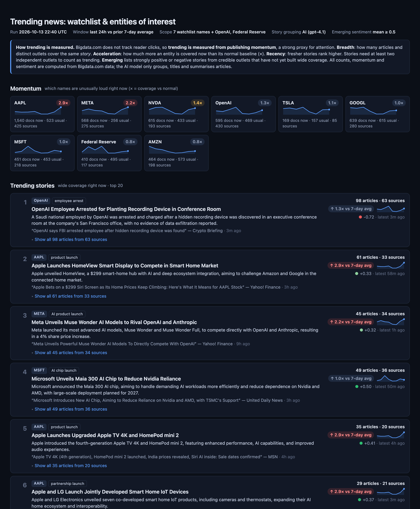
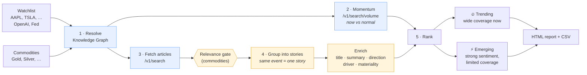
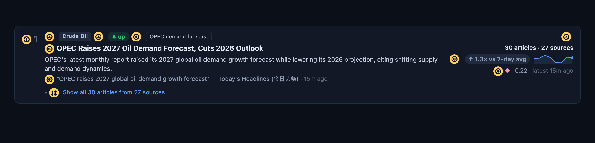
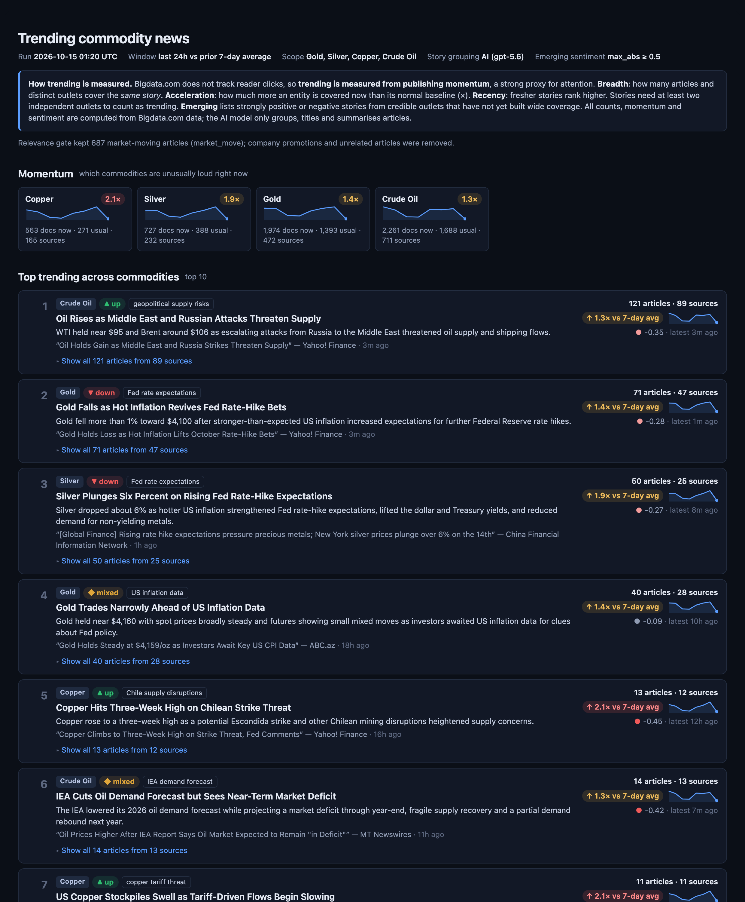
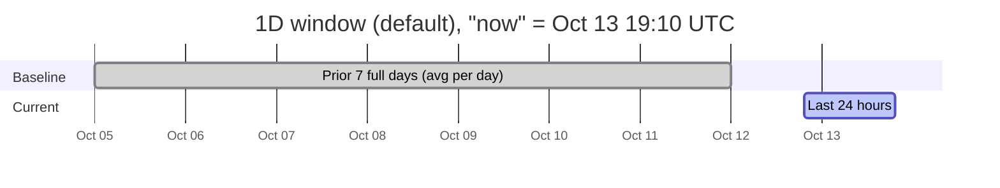
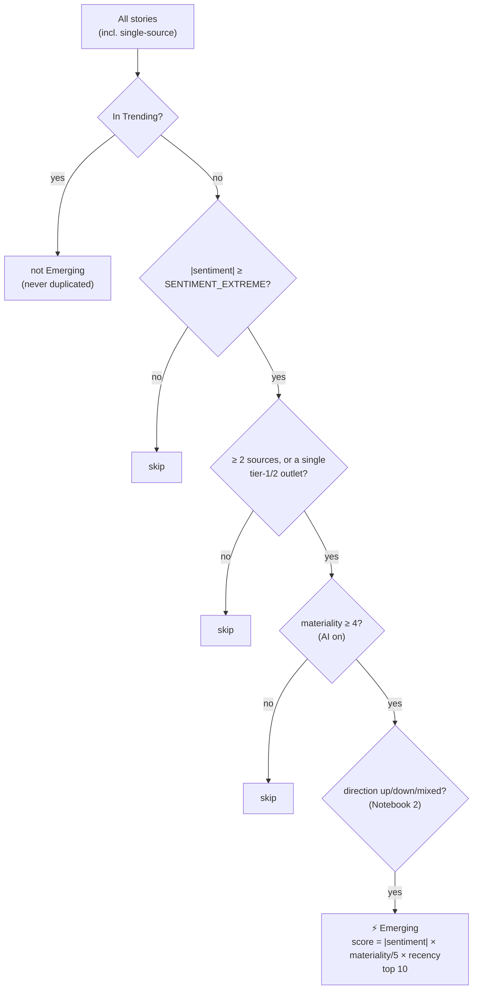

# Trending News with Bigdata.com

**What is trending right now, not just what is relevant.**
Two ready-to-run notebooks that find the news stories gaining momentum for (1) a watchlist of companies and
entities of interest, and (2) commodities such as gold, silver, copper and oil, including whether each
story points **up or down**. Powered by [Bigdata.com](https://bigdata.com).



| | Notebook | Answers | Run in the cloud |
|---|---|---|---|
| 1 | [`notebooks/01_watchlist_trending.ipynb`](notebooks/01_watchlist_trending.ipynb) | *Which stories about my companies and entities are trending right now?* | [](https://colab.research.google.com/github/Bigdata-com/bigdata-trending-news/blob/main/notebooks/01_watchlist_trending.ipynb) |
| 2 | [`notebooks/02_commodities_trending.ipynb`](notebooks/02_commodities_trending.ipynb) | *Which gold, silver, copper, oil… stories are trending, and is the move up or down?* | [](https://colab.research.google.com/github/Bigdata-com/bigdata-trending-news/blob/main/notebooks/02_commodities_trending.ipynb) |

Each notebook runs top to bottom in about 2 minutes ([run time](#run-time)) and ends with a **self-contained HTML report** (one file, no
external assets, opens in any browser or can be emailed) plus CSV files in `outputs/`. Sample reports from a real
run are in [`outputs/samples/`](outputs/samples/).

---

## Contents

1. [How it works](#how-it-works) (for business readers)
2. [Quick start](#quick-start) (including [run time](#run-time))
3. [Run it every hour](#run-it-every-hour)
4. [Reading the report](#reading-the-report)
5. [The pipeline in detail](#the-pipeline-in-detail)
6. [Tuning](#tuning)
7. [Limitations](#limitations)
8. [Implementation notes](#implementation-notes)
9. [Project layout](#project-layout)

---

## How it works

Bigdata.com does not track clicks or reads, so **"trending" is measured from publishing momentum**: when many
independent outlets write about the same event at once, and an entity is covered far more than usual, that is where
attention is.

1. **Discover / Resolve.** Your tickers, names and commodities are matched to Bigdata.com entities in the
   Knowledge Graph.
2. **Measure momentum.** For each entity we compare today's news volume with its normal level
   (`/v1/search/volume`): "Apple is covered 2.6× more than usual."
3. **Group similar articles into stories.** Current articles (`/v1/search`) that report the *same event* are
   grouped, so 90 articles from 70 outlets become one story.
4. **Rank trending.** Stories rank higher with more articles, more distinct outlets, a louder entity, and fresher
   coverage. A story needs at least two outlets.
5. **Flag emerging signals.** A second list catches stories with strongly positive or negative sentiment from
   credible outlets *before* coverage builds.

**Trending** = wide coverage right now. **Emerging** = strong sentiment from credible sources, not yet widely covered.

An AI model is used for the relevance filter (commodities), story grouping, titles and summaries, and up/down
direction. **All counts, momentum figures and sentiment come from Bigdata.com data, never from the AI model.**


<sub>Blue = Bigdata.com API · Amber = AI model (optional; every AI step has a non-AI fallback)</sub>

---

## Quick start

**Requirements:** Python 3.10+ and a Bigdata.com API key. An OpenAI API key is optional.

```bash
cd trending-news-demo
python3 -m venv .venv && source .venv/bin/activate     # Windows: py -m venv .venv && .venv\Scripts\activate
python -m pip install -r requirements.txt               # "python -m pip" installs into the venv, never globally

cp .env.example .env        # then add BIGDATA_API_KEY and OPENAI_API_KEY
jupyter lab notebooks/
```

> **Setup trouble?** If `python3 -m venv .venv` fails with an `ensurepip` error, or `which pip` does not point inside
> `.venv/`, an old or half-created `.venv` folder is in the way. Delete it and start again:
> `rm -rf .venv` (Windows: `rmdir /s /q .venv`), then repeat the two commands above.

Open a notebook and choose **Run → Run All Cells**.

**Or run it in Google Colab, with nothing to install:** click an **Open in Colab** badge above.

1. Click the 🔑 **Secrets** icon in Colab's left sidebar and add `BIGDATA_API_KEY` and `OPENAI_API_KEY`.
   Switch on **Notebook access** for each. A Bigdata.com key is required.
2. **While the repository is private:** Colab asks you to authorise GitHub when you open the notebook. Allow it, and
   tick *Include private repos*. Also add a `GITHUB_TOKEN` secret: a GitHub
   [fine-grained token](https://github.com/settings/personal-access-tokens) with read-only *Contents* access to
   this repository, so the setup cell can download the code.
3. **Runtime → Run all.** The first code cell ("0. Google Colab only") downloads the code and installs the
   packages (usually under a minute). Outside Colab it does nothing.
4. Reports are saved in Colab's temporary storage, under `bigdata-trending-news/outputs/` (📁 Files panel); download
   any you want to keep. The report is also shown inside the notebook.

| Mode | When | What happens |
|---|---|---|
| **Live** | `BIGDATA_API_KEY` is set | Calls Bigdata.com (and the LLM). Responses are cached locally for 10 minutes |
| **No AI** | `cfg.USE_LLM = False` (or no LLM key) | Text-similarity grouping, headline titles, keyword-based direction |

**LLM.** The notebooks use OpenAI GPT 5.6 (`OPENAI_API_KEY`). Override the model with `LLM_MODEL`.

**Cost of a live run** (1-day window, defaults): Notebook 1 uses about 380 Bigdata.com query units (9 entities),
Notebook 2 about 135 (4 commodities); about 40 and 20–30 LLM calls respectively. Re-running within 10 minutes reuses
the cached responses at no cost.

### Run time

Every code cell prints how long it took when it finishes (`⏱ 12.3 s`), each notebook section states its typical
duration, and the last cell of each notebook shows a table of time per step. Measured on the reference live run:

| Step | Notebook 1 (9 entities) | Notebook 2 (4 commodities) |
|---|---|---|
| Setup, configuration, resolve entities | under 1 s | under 1 s |
| Momentum (`/v1/search/volume`) | 3 s | 2 s |
| Fetch → relevance gate → group → enrich → rank | 1 min 47 s | 1 min 36 s |
| Emerging, report, save | under 1 s | under 1 s |
| **Total** (Bigdata.com + OpenAI) | **1 min 50 s** | **1 min 38 s** |

Almost all of the time is the AI model (grouping and enriching stories) and Bigdata.com calls, so it varies with
the LLM provider's response times and with how much news there is. Re-runs within 10 minutes reuse the local cache.

---

## Run it every hour

`scripts/run_notebooks.py` runs both notebooks headless, exactly as **Run All** would, and stores each run in its own
folder. Point any scheduler at it.

**1. Test it once by hand** (from the `trending-news-demo` folder, with your keys in `.env`):

```bash
.venv/bin/python scripts/run_notebooks.py                       # both notebooks, about 3-4 minutes
.venv/bin/python scripts/run_notebooks.py --only commodities    # just one
```

```
outputs/
├── runs/
│   ├── 2026-10-13_1900Z/                 one folder per run (UTC start time)
│   │   ├── watchlist_trending_2026-10-13.html   + *_trending.csv, *_emerging.csv
│   │   ├── commodities_trending_2026-10-13.html + CSVs
│   │   ├── 01_watchlist_trending.ipynb   executed copy, with all outputs and ⏱ cell timings
│   │   ├── 02_commodities_trending.ipynb
│   │   └── run.log                       status and duration per notebook
│   └── 2026-10-13_2000Z/ …
└── latest/                               newest reports under fixed names: bookmark these
    ├── watchlist_trending.html
    └── commodities_trending.html  (+ CSVs)
```

The notebooks in `notebooks/` are never modified by the runner.

**2. Schedule it.** Replace `/path/to/trending-news-demo` with the real folder.

*macOS / Linux (cron).* Run `crontab -e` and add this line (runs at 5 minutes past every hour):

```cron
5 * * * * cd /path/to/trending-news-demo && .venv/bin/python scripts/run_notebooks.py >> outputs/scheduler.log 2>&1
```

*macOS (launchd), preferred on a laptop:* unlike cron, it catches up on a run missed while the Mac was asleep. Save
as `~/Library/LaunchAgents/com.example.trending-news.plist`, then run
`launchctl load ~/Library/LaunchAgents/com.example.trending-news.plist`:

```xml
<?xml version="1.0" encoding="UTF-8"?>
<!DOCTYPE plist PUBLIC "-//Apple//DTD PLIST 1.0//EN" "http://www.apple.com/DTDs/PropertyList-1.0.dtd">
<plist version="1.0">
<dict>
  <key>Label</key>             <string>com.example.trending-news</string>
  <key>ProgramArguments</key>
  <array>
    <string>/path/to/trending-news-demo/.venv/bin/python</string>
    <string>/path/to/trending-news-demo/scripts/run_notebooks.py</string>
  </array>
  <key>StartInterval</key>     <integer>3600</integer>
  <key>StandardOutPath</key>   <string>/path/to/trending-news-demo/outputs/scheduler.log</string>
  <key>StandardErrorPath</key> <string>/path/to/trending-news-demo/outputs/scheduler.log</string>
</dict>
</plist>
```

*Windows (Task Scheduler)*, from a Command Prompt:

```bat
schtasks /Create /SC HOURLY /TN "Trending News" ^
  /TR "C:\path\to\trending-news-demo\.venv\Scripts\python.exe C:\path\to\trending-news-demo\scripts\run_notebooks.py"
```

*Server or cloud:* run the same command from any scheduler you already use (Airflow, a Kubernetes CronJob,
GitHub Actions `schedule:`), with the API keys supplied as secrets / environment variables.

**3. Good to know**

| Topic | Detail |
|---|---|
| API keys | Read from `.env` in the project folder (or the environment). Schedulers do not load your shell profile, so `.env` is the simplest place for them. |
| Cost | One run of both notebooks ≈ 515 Bigdata.com query units plus 60-70 LLM calls, so **≈ 12,000 units per day** at an hourly schedule. To spend less: run every 2-3 hours (`5 */3 * * *`), run one notebook (`--only`), or switch the AI model off (`cfg.USE_LLM = False`). |
| Overlapping runs | If the previous run is still going, the new one is skipped (lock file `outputs/runs/.lock`, ignored once older than 2 hours). |
| Disk | Run folders older than 7 days are deleted automatically; change with `--keep-days 3`. Each run is about 1-2 MB. |
| Failures | The script exits with a non-zero code (schedulers can alert on it), records the error in `run.log`, and keeps the partly executed notebook in the run folder so you can see which cell failed. |
| Comparing hours | The 1-day window is a rolling 24 hours, so each hourly run shows how rankings moved. Compare `outputs/runs/*/watchlist_*_trending.csv` to track a story's rank over the day. |
| Seeing the run | Open `outputs/latest/*.html` for the newest report, or an executed notebook in a run folder for every table and the ⏱ timings. |

---

## Reading the report



| # | Element | Meaning | Source |
|---|---|---|---|
| ① | Rank | Position by trend score | computed |
| ② | Entity chips | The watchlist names / commodities the story is about | Bigdata.com entity detection |
| ③ | Direction (Notebook 2) | ▲ up / ▼ down / ◆ mixed: the implication for the commodity's price | AI model (keyword fallback) |
| ④ | Driver | Short tag for what is driving the story | AI model |
| ⑤ | Story title & summary | Neutral title (≤ 12 words) and one sentence, grounded only in the articles | AI model |
| ⑥ | Representative article | The article that best represents the story, its outlet and age | AI model picks; data from Bigdata.com |
| ⑦ | Breadth | `N articles · M sources`: how many articles and distinct outlets cover this story | Bigdata.com search |
| ⑧ | Momentum | How loud the story's entity is vs its normal level, with the daily-volume sparkline | Bigdata.com volume |
| ⑨ | Sentiment | Average Bigdata.com sentiment of the story (−1 … +1), and time since the latest article | Bigdata.com |
| ⑩ | Show all articles | Every article in the story: time, outlet, headline link, sentiment | Bigdata.com search |

> **Sentiment is not price direction.** Sentiment measures the tone of the news *for the entity mentioned*; direction
> is the implication for the price. A mine strike reads as negative news (sentiment −0.6) and is bullish for copper
> (direction ▲ up). Both are shown on purpose.

The report header shows the run time, window, scope and a "How trending is measured" note. Below the Trending list is
the **Emerging** section, styled as secondary (dashed outline). Notebook 2 groups everything by commodity: the
header shows the commodity's momentum and the net direction of its top stories (e.g. "Gold ↑ 1.2× · ▼ mostly down"),
followed by its Trending stories and then its Emerging items, with a combined "Top trending across commodities" list
at the top.



---

## The pipeline in detail

### Definition of "trending"

Bigdata.com does **not** capture reader engagement (clicks, reads, shares). Trending is measured from **publishing
momentum**, a strong proxy for attention:

* **Breadth:** how many articles and distinct outlets are covering the *same story*. This is the
  "engagement around similar articles".
* **Acceleration:** coverage of the entity now versus its normal baseline.
* **Recency:** fresher stories rank higher.

If you have click or read data, blend it in through the `external_engagement_score(story)` hook in
[`trending/rank.py`](trending/rank.py) (default 0).

### Time windows



| Window | Current | Baseline | Recency half-life H |
|---|---|---|---|
| `1D` (default) | last 24 hours | the 7 full days before | 12 h |
| `1W` | last 7 days | the 28 full days before | 72 h |

### Steps

| Step | Module | What it does |
|---|---|---|
| 1. Resolve | [`resolve.py`](trending/resolve.py) | Tickers → `/v1/knowledge-graph/companies` (validated against known IDs). Free text → companies, organizations, people, concepts, products, places. Commodities → concepts of type *Commodity*. If several entities match, the one with the most news in the past week wins. Unresolvable commodities run in **keyword mode** (search phrases, no entity filter). Resolved IDs are cached locally in `fixtures/entities.json` (not committed). |
| 2. Momentum | [`momentum.py`](trending/momentum.py) | `/v1/search/volume`, NEWS only. **Call A** (baseline + current, daily buckets) → baseline average per day and the sparkline. **Call B** (current window, `group_by: ["source"]`) → `current_docs = total.documents`, `distinct_sources = len(groups.sources)`, `total.sentiment`. **`spike = (current_docs + 1) / (baseline_per_period + 1)`** |
| 3. Fetch | [`fetch.py`](trending/fetch.py) | `/v1/search`, fast mode, NEWS, entity filter (`search_in: HEADLINE` by default), current window, `max_chunks: 1000`. De-duplicated to documents: ID, headline, source, source rank, time, URL, best chunk, sentiment. |
| Gate | [`enrich.py`](trending/enrich.py) | *Notebook 2 only.* Each article → `market_move` / `company_specific` / `irrelevant`; keeps `market_move`. Without AI: drops `(TSXV:XXX)`-style tickers, "stocks to buy" and question-style promo headlines. |
| 4. Group | [`cluster.py`](trending/cluster.py) | AI groups articles reporting the **same specific event** (batches of ≤ 120, strict JSON, validated: every article exactly once). Batches and entities are merged when they overlap; a final pass merges duplicates among the top 60. Without AI: headline word-overlap (Jaccard ≥ 0.6, union-find). Story stats are computed **in code**: `articles`, distinct `sources`, `first_seen`, `last_seen`, `avg_sentiment`. |
| 5. Enrich | [`enrich.py`](trending/enrich.py) | For the top ~30 stories (+ Emerging candidates): `title`, `summary`, `direction`, `driver`, `materiality` (1–5), `representative_id`. The model uses only the supplied text and answers `n/a` rather than guess. |
| 6. Rank | [`rank.py`](trending/rank.py) | Trend score (below); Trending keeps stories with ≥ 2 sources, top 20. Emerging (6b) is a separate list. |
| 7. Render | [`render.py`](trending/render.py) | HTML report (dark theme, inline SVG sparklines, expandable member lists), DataFrames, CSVs. |

### Trend score

```
recency = exp(−hours_since(last_seen) / H)                 H = 12 (1D), 72 (1W)
trend   = 0.30·log(1 + articles) + 0.25·log(1 + sources)
        + 0.25·log(spike of the story's entity)             # loudest entity if several
        + 0.10·recency
        + 0.10·(materiality / 5)                            # 0 if the AI model is off
        + external_engagement_score                         # your data, default 0
```

### Emerging (Step 6b)



Sentiment always comes from Bigdata.com chunk sentiment, never from the AI model. With the AI model off, materiality
is taken as 3 in the score.

---

## Tuning

All settings live in [`trending/config.py`](trending/config.py) and can be overridden in a notebook's
configuration cell (`cfg.NAME = value`).

| Setting | Default | Effect |
|---|---|---|
| `WINDOW` | `"1D"` | `"1D"` = last 24h vs prior 7 days; `"1W"` = last 7 days vs prior 28 days |
| `AS_OF` | now | Pin the reference time, e.g. `"2026-10-13T19:10:00Z"` |
| `WATCHLIST`, `ENTITIES_OF_INTEREST` | 7 tickers, OpenAI, Federal Reserve | What Notebook 1 tracks (set in the notebook) |
| `COMMODITIES`, `COMMODITY_SELECTION` | 7 defined, 4 selected | Commodity definitions: `kg_query` + search `texts` |
| `SEARCH_IN` / `MOMENTUM_SEARCH_IN` | `"HEADLINE"` | `"ALL"` also counts articles that only mention the entity |
| `MAX_CHUNKS`, `FETCH_SLICES` | 1000, 1 | Retrieval depth; more slices = more articles per entity, higher cost |
| `WEIGHTS` | 0.30 / 0.25 / 0.25 / 0.10 / 0.10 | Trend score weights (articles, sources, spike, recency, materiality) |
| `TRENDING_MIN_SOURCES`, `TRENDING_TOP_N` | 2, 20 | Minimum outlets for a trending story; list length |
| `TOP_N_PER_GROUP`, `COMBINED_TOP_N` | 5, 10 | Notebook 2: stories per commodity; combined list length |
| `SENTIMENT_EXTREME` | 0.5 | Emerging: minimum \|sentiment\| |
| `SENTIMENT_MODE` | `"mean"` | Emerging: `"mean"` of the story's chunks, or `"max_abs"` (strongest single chunk) |
| `EMERGING_MAX_SOURCE_RANK` | 2 | Single-source Emerging stories need an outlet of rank 1–2 |
| `EMERGING_MIN_MATERIALITY`, `EMERGING_TOP_N` | 4, 10 | Emerging: AI materiality floor; list length |
| `GATE_KEEP` | `["market_move"]` | Notebook 2: article classes kept by the relevance gate |
| `USE_LLM`, `LLM_MODEL` | on, `gpt-5.6` | AI model on/off; OpenAI model name |
| `LEXICAL_JACCARD` | 0.6 | No-AI grouping: headline word overlap needed to join a story |
| `CROSS_ENTITY_OVERLAP`, `ENTITY_MIN_SHARE`, `DEDUPE_TOP_K` | 0.5, 0.3, 60 | Story merging across entities, entity chips, final duplicate pass |
| `external_engagement_score()` | 0 | Function in `rank.py`: add your own click/read data |

### Emerging settings used in this demo

| Notebook | `SENTIMENT_MODE` | `SENTIMENT_EXTREME` | Why |
|---|---|---|---|
| 1. Watchlist | `"mean"` | 0.5 | Company news has a clear tone; the list fills with 7–10 strong items per day (lawsuits, fines, analyst upgrades). |
| 2. Commodities | `"max_abs"` | 0.5 | Commodity news is mostly neutral price reporting, which dilutes a story's *mean* sentiment, and with `"mean"` the list was nearly empty. `"max_abs"` uses the strongest passage, so sharp but quiet events (a mine strike threat, a central bank selling gold) appear. |

If the list is still too quiet, lower `SENTIMENT_EXTREME` to about 0.35. If it is too noisy, raise it or set
`EMERGING_MIN_MATERIALITY = 5`.

---

## Limitations

* **No click or read data.** Trending is inferred from publishing momentum (breadth, acceleration, recency), not
  audience engagement. Use the `external_engagement_score` hook to blend in your own data.
* **Search de-duplicates, so article counts understate coverage.** `/v1/search` diversifies its results and drops
  near-identical passages, and returns a bounded number of chunks per call. `N articles · M sources` per story is
  therefore a lower bound, used for grouping and display. Entity-level momentum (×) comes from `/v1/search/volume`,
  which counts all documents.
* **Daily volume buckets.** Volume is bucketed by UTC calendar day, so the last sparkline point (today) is partial. The
  current 24-hour count uses an exact rolling window (volume Call B), not the partial bucket.
* **Mean sentiment can be diluted.** A story's average sentiment is pulled toward zero by neutral passages
  (prices, background). Notebook 1 uses `"mean"`; Notebook 2 uses `"max_abs"` for this reason (see Tuning).
* **AI grouping is a judgement call.** The model decides what counts as "the same event"; borderline cases (a
  product launch and the share-price reaction to it) may be grouped or split. Counts and momentum are never produced
  by the model, and every AI step has a deterministic fallback.
* **Momentum is per entity, not per story.** A story inherits the spike of its (loudest) entity.

---

## Implementation notes

Request and response shapes were verified against the OpenAPI specs at docs.bigdata.com and against live responses.
Where the live API behaves differently from what its field names suggest, the code follows the live behaviour:

| Topic | Note |
|---|---|
| Source rank | Returned as a string (`"RANK_1"` … `"RANK_5"`); parsed to an integer (1 = top tier). |
| Timestamps | Search returns `2026-10-13T05:30:18` without a timezone; treated as UTC. |
| Search body | `query.max_chunks` (≤ 1000) is the chunk-limit field. `query.text` and `query.texts` are mutually exclusive, and **more than one `texts` requires `ranking_params.reranker.text`**, which the client sets automatically. |
| Volume | `results.volume[]` = daily `{date, documents, chunks, sentiment}`; with `group_by: ["source"]`, `results.groups.sources[]` = `{id, documents, chunks}` (no source names, which are taken from search results). Timestamp span ≤ 1 year. |
| Knowledge Graph | `POST /v1/knowledge-graph/{companies,concepts,organizations,people,products,places}` with `{"query": …}` → `results[]`. Commodities are **concepts** with `type: "Commodity"` (Gold `9768FE`, Silver `F96E34`, Copper `A4090F`, Crude Oil `FD9CFE`); product search returns consumer products and is not used for them. Names for IDs come from `/v1/knowledge-graph/entities/id`. |
| Entity disambiguation | Free-text names often match many entities (e.g. "Federal Reserve" → the central bank and regional Fed banks). The best name matches are compared by past-week news volume: "OpenAI" → *OpenAI Foundation* (`UWCVKI`), "Federal Reserve" → *United States Federal Reserve* (`F38FC4`). |
| OpenAI calls | Temperature 0 and JSON mode. The default model is `gpt-5.6`. |
| Story quality safeguards | (a) Stories from different entities merge only if they share ≥ 50% of the smaller story's articles, so a single round-up article cannot chain unrelated stories. (b) A final pass merges duplicates among the top 60 stories, only when they share an entity. (c) "Miscellaneous"-style catch-all groups returned by the model are regrouped lexically. (d) An entity chip is shown only if the entity is detected in ≥ 30% of the story's articles. |
| Local cache | API and LLM responses are stored as gzipped JSON under `fixtures/`, keyed by a hash of the request/prompt. API entries expire after 10 minutes. `fixtures/` is gitignored. |

**Testing performed** (live, 13 Oct 2026): both notebooks executed top to bottom live with Bigdata.com and OpenAI;
both notebooks were then re-run with `USE_LLM=False`. The top stories were inspected
for misclusters and junk; that review led to the safeguards above.

---

## Project layout

```
trending-news-demo/
├── README.md
├── LICENSE                       MIT
├── requirements.txt
├── .env.example                  BIGDATA_API_KEY, OPENAI_API_KEY, LLM_MODEL
├── notebooks/
│   ├── 01_watchlist_trending.ipynb
│   └── 02_commodities_trending.ipynb
├── trending/                     shared package (the notebooks stay thin)
│   ├── config.py                 every weight, threshold, window and entity list
│   ├── bigdata.py                REST client: search, volume, KG; retries, cache, concurrency ≤ 5
│   ├── cache.py                  local disk cache for API and LLM responses
│   ├── resolve.py                names / tickers → entity IDs (Knowledge Graph)
│   ├── momentum.py               baseline vs current, source breadth, sparkline data
│   ├── fetch.py                  current-window news, de-duplicated to documents
│   ├── llm.py                    OpenAI wrapper (GPT 5.6), JSON helpers
│   ├── cluster.py                articles → stories (AI, with lexical fallback)
│   ├── enrich.py                 titles, summaries, direction, driver, materiality; relevance gate
│   ├── rank.py                   trend score, Emerging list, engagement hook
│   ├── render.py                 HTML report, DataFrames, CSV
│   ├── pipeline.py               glue used by the notebooks
│   └── timing.py                 per-cell ⏱ timer and run-time summary
├── scripts/
│   └── run_notebooks.py          headless runner for scheduled (e.g. hourly) runs
├── outputs/                      generated reports (git-ignored); outputs/samples/ = committed examples;
│                                 outputs/runs/ and outputs/latest/ = scheduled runs
└── docs/                         images used in this README
```

**Engineering:** REST with the `X-API-KEY` header against `https://api.bigdata.com`; `httpx` with at most 5 concurrent
requests, exponential backoff on 429/5xx (3 attempts), and per-entity failure isolation (a failing entity is logged
and skipped); a 10-minute disk cache; no secrets in code or notebooks.

---

## License

The code is released under the [MIT License](LICENSE). News content returned by Bigdata.com (including the
sample reports) remains subject to your Bigdata.com terms of use.
